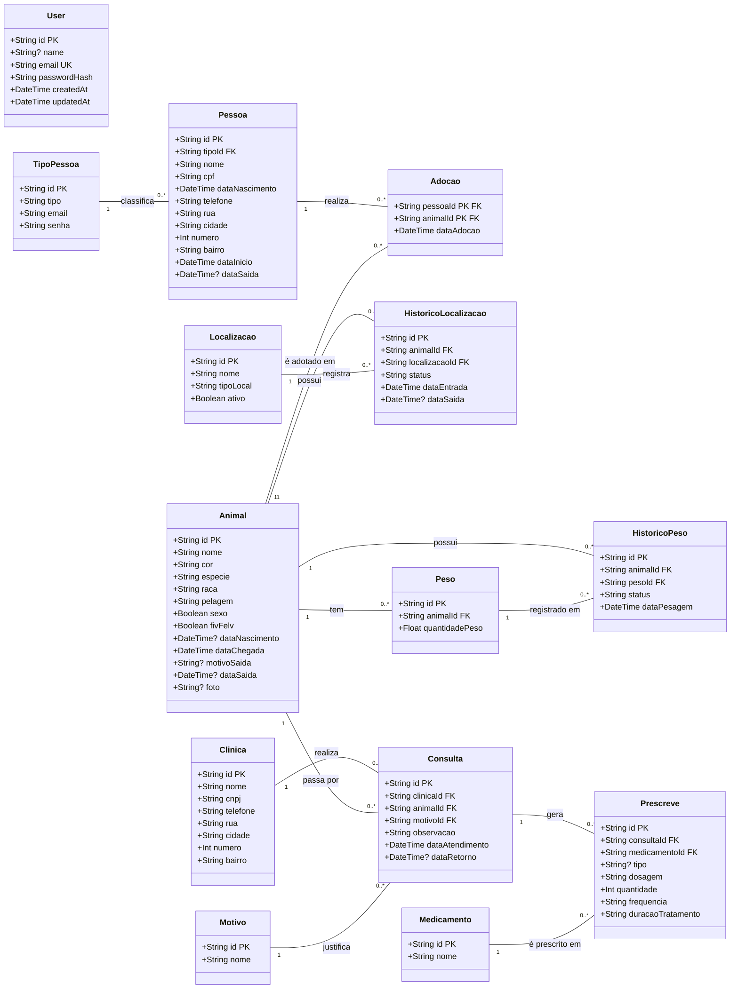

# Diagrama de classes

Modelo de dados do CadasPatas, lido de `prisma/schema.prisma`. Cada classe é uma tabela do PostgreSQL. As chaves primárias estão marcadas com `PK` e as chaves estrangeiras com `FK`. Campos com `?` são opcionais.

## Legenda

| Marca | Significado |
| --- | --- |
| `PK` | Chave primária |
| `FK` | Chave estrangeira |
| `UK` | Valor único |
| `?` | Campo opcional |

## Chaves estrangeiras

| Tabela | Campo | Referencia |
| --- | --- | --- |
| `Pessoa` | `tipoId` | `TipoPessoa.id` |
| `Adocao` | `pessoaId` | `Pessoa.id` |
| `Adocao` | `animalId` | `Animal.id` |
| `HistoricoLocalizacao` | `animalId` | `Animal.id` |
| `HistoricoLocalizacao` | `localizacaoId` | `Localizacao.id` |
| `Peso` | `animalId` | `Animal.id` |
| `HistoricoPeso` | `animalId` | `Animal.id` |
| `HistoricoPeso` | `pesoId` | `Peso.id` |
| `Consulta` | `clinicaId` | `Clinica.id` |
| `Consulta` | `animalId` | `Animal.id` |
| `Consulta` | `motivoId` | `Motivo.id` |
| `Prescreve` | `consultaId` | `Consulta.id` |
| `Prescreve` | `medicamentoId` | `Medicamento.id` |

## Observações

- `Adocao` é uma classe de associação entre `Pessoa` e `Animal`. A chave primária é composta por `pessoaId` e `animalId`, então a mesma pessoa não adota o mesmo animal duas vezes.
- `Prescreve` liga `Consulta` e `Medicamento`, mas tem `id` próprio e guarda os dados da prescrição.
- `User` não se relaciona com nenhuma outra tabela. Ele é usado só para o login.
