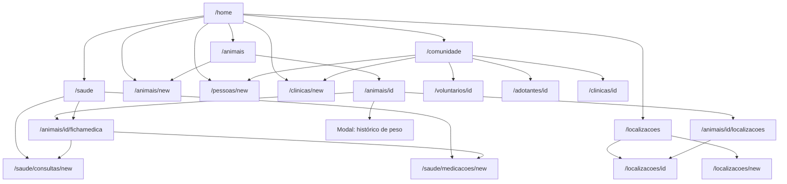
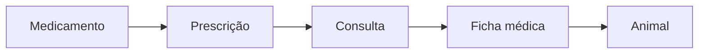

# Fluxo de páginas

Mapa de navegação do CadasPatas. A entrada das seções é a home (`/home`) e o menu lateral. Cada seção abre uma lista, um cadastro ou uma página de detalhe. O histórico de peso abre em modal na página do animal.

## Home

Rota: `/home`

A home abre as cinco áreas do sistema:

| Destino | Rota | O que abre |
| --- | --- | --- |
| Animais | `/animais` | Lista de animais |
| Comunidade | `/comunidade` | Voluntários, adotantes e clínicas |
| Saúde animal | `/saude` | Fichas médicas e o histórico de consultas |
| Gatis e localizações | `/localizacoes` | Lista de locais |
| Cadastrar animal | `/animais/new` | Formulário de animal |
| Cadastrar pessoa | `/pessoas/new` | Formulário de pessoa |
| Cadastrar clínica | `/clinicas/new` | Formulário de clínica |

## Animais

Rota: `/animais`

Lista todos os animais. Cada animal abre a página de visualização e edição. O botão de cadastro abre o formulário novo.

| Ação | Rota | Conteúdo |
| --- | --- | --- |
| Ver e editar | `/animais/[idAnimal]` | Dados cadastrados do animal |
| Cadastrar | `/animais/new` | Formulário de novo animal |

Em `/animais/[idAnimal]`, além dos dados cadastrados:

| Ação | Onde abre | Conteúdo |
| --- | --- | --- |
| Ficha médica | `/animais/[idAnimal]/fichamedica` | Ficha daquele animal, lida das consultas |
| Histórico de peso | Modal | Pesagens daquele animal |
| Histórico de localização | `/animais/[idAnimal]/localizacoes` | Locais pelos quais o animal passou |

A ficha médica é uma por animal. Ela não guarda o atendimento: ela mostra a consulta escolhida. Cada consulta é uma edição dessa ficha e fica no histórico. A consulta, por sua vez, mostra a prescrição e os medicamentos daquela edição.

Na ficha, a consulta mais recente abre primeiro. O histórico lista todas as edições, e escolher uma linha troca o atendimento e a prescrição exibidos. Nova consulta grava uma edição. Nova medicação entra na consulta que está em exibição.

O histórico de localização leva à página do local, `/localizacoes/[idLocalizacao]`.

## Saúde animal

Rota: `/saude`

A página tem duas listas. Fichas médicas é uma ficha por animal e abre `/animais/[idAnimal]/fichamedica`. Consultas é o histórico das edições e abre a mesma ficha já na consulta escolhida.

| Ação | Rota | Regra |
| --- | --- | --- |
| Abrir uma ficha | `/animais/[idAnimal]/fichamedica` | Uma ficha por animal |
| Abrir uma consulta | `/animais/[idAnimal]/fichamedica?consulta=[idConsulta]` | Uma edição da ficha |
| Nova consulta | `/saude/consultas/new` | O animal é obrigatório. Grava uma edição da ficha |
| Nova medicação | `/saude/medicacoes/new` | Entra numa consulta daquele animal. A consulta é obrigatória |

`/saude/fichas/new` redireciona para `/saude/consultas/new`. A medicação não tem lista própria: ela aparece dentro da consulta, na prescrição da ficha.

## Comunidade

Rota: `/comunidade`

A página lista voluntários, adotantes e clínicas. Cada tipo tem a própria página de detalhe, para que voluntário, adotante e clínica possam ser construídos de acordo com a necessidade de cada um. Os formulários de cadastro também saem daqui.

| Ação | Rota | Conteúdo |
| --- | --- | --- |
| Abrir voluntário | `/voluntarios/[idVoluntario]` | Página do voluntário |
| Abrir adotante | `/adotantes/[idAdotante]` | Página do adotante |
| Abrir clínica | `/clinicas/[idClinica]` | Página da clínica |
| Cadastrar pessoa | `/pessoas/new` | Formulário de pessoa |
| Cadastrar clínica | `/clinicas/new` | Formulário de clínica |

Voluntário e adotante não compartilham a mesma rota de detalhe. `/pessoas/[idPessoa]` não é o destino desses cards.

## Gatis e localizações

Rota: `/localizacoes`

Lista todos os locais. Cada local abre a página com os dados do lugar e os animais que estão nele. O cadastro abre um local novo.

| Ação | Rota | Conteúdo |
| --- | --- | --- |
| Ver local | `/localizacoes/[idLocalizacao]` | Dados do local e animais nele |
| Cadastrar local | `/localizacoes/new` | Formulário de nova localização |

## Rotas

| Rota | Página |
| --- | --- |
| `/home` | Home |
| `/animais` | Lista de animais |
| `/animais/new` | Cadastro de animal |
| `/animais/[idAnimal]` | Dados cadastrados, com atalho para a ficha e modal de peso |
| `/animais/[idAnimal]/fichamedica` | Ficha médica do animal, lida da consulta selecionada |
| `/animais/[idAnimal]/localizacoes` | Histórico de localização do animal |
| `/saude` | Fichas médicas e histórico de consultas |
| `/saude/consultas/new` | Nova consulta, edição da ficha, com animal obrigatório |
| `/saude/fichas/new` | Redireciona para `/saude/consultas/new` |
| `/saude/medicacoes/new` | Nova medicação numa consulta |
| `/comunidade` | Voluntários, adotantes e clínicas |
| `/voluntarios/[idVoluntario]` | Voluntário |
| `/adotantes/[idAdotante]` | Adotante |
| `/clinicas/[idClinica]` | Clínica |
| `/pessoas/new` | Cadastro de pessoa |
| `/clinicas/new` | Cadastro de clínica |
| `/localizacoes` | Gatis e localizações |
| `/localizacoes/[idLocalizacao]` | Local e animais nele |
| `/localizacoes/new` | Cadastro de localização |
